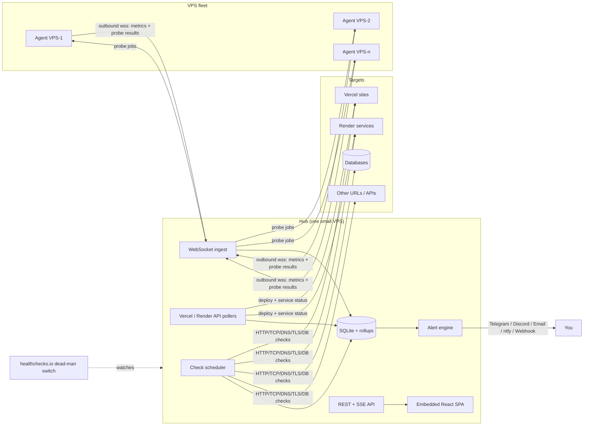

# Hook — Infra Watch Plan

One private site that answers two questions at a glance:

1. **Is everything up?** Websites, web apps, APIs, databases on Vercel, Render, VPSes and anywhere else.
2. **How are my servers doing?** Live and historical resource usage of every VPS, down to disks, containers and processes.

Working name: **Hook** (the folder name). Rename any time.

> **Status (2026-10-27):** Phases 0–6 are built and tested locally (see [README.md](README.md)). Vercel/Render, the database drivers and Docker were tested against local fakes and protocol-level test servers, not live services; the "failed from the hub but reachable elsewhere" case of multi-location confirmation needs two networks and is covered by unit tests only. Not built from the original lists: dependency suppression, latency anomaly baselines and email digests (Phase 5), and the audit log (Phase 6). Web Push delivery is verified by a test that decrypts the payload as a browser would, not on a real phone, and the Litestream config hasn't been run (Litestream isn't installed locally).

---

## 1. Build vs. adopt (honest check)

Uptime Kuma (uptime) + Beszel (VPS metrics) already cover maybe 70% of this. Building our own is worth it for:

- **One dashboard** for both, instead of two tools and two logins.
- **Platform awareness**: Vercel and Render APIs (failed deploys, suspended services, Render free-tier sleeping) that neither tool understands.
- **Multi-location confirmation**: your VPSes double as probe locations, so a site is only "down" when 2+ locations agree.
- **Your design**: the bento components, not a generic admin UI.

What we borrow from Uptime Kuma is the *feature list* (monitor types, heartbeat bar, status pages, maintenance windows, notification channels), not its code or stack.

---

## 2. Recommended stack (lightweight first)

| Layer | Choice | Why |
|---|---|---|
| **Agent** (runs on each VPS) | **Go**, single static binary | ~10–15 MB RAM, <1% CPU, no runtime to install, cross-compiles to amd64/arm64. Uses `gopsutil` for metrics. |
| **Hub** (the central server) | **Go**, single binary | Same language as the agent (shared protocol types). ~40–60 MB RAM. Embeds the built frontend, so deploy = copy one file. |
| **Database** | **SQLite** (WAL mode) via `modernc.org/sqlite` (pure Go, no CGO) | Zero ops. Handles this load easily with rollups (see §6). No Postgres/Influx/Prometheus to babysit. |
| **Backups** | **Litestream** → Cloudflare R2 / S3 | Continuous SQLite replication, tiny sidecar. |
| **Live updates** | **WebSocket** (agents → hub), **SSE** (hub → browser) | SSE is simpler than Socket.io and enough for one-way live data. |
| **Frontend** | **React 19 + Vite + TypeScript + Tailwind v4** | Pure SPA (no SSR needed for a private dashboard), so no Next.js. Builds to static files the hub serves. |
| **Charts** | **Hand-rolled SVG** (like the bento files) + **uPlot** (~45 KB) for dense time-series | Bento cards stay dependency-free; uPlot draws 100k-point CPU/latency charts without lag. No Recharts/Chart.js. |
| **Reverse proxy / TLS** | **Caddy** | Automatic HTTPS, 3 lines of config. |
| **Data fetching** | TanStack Query + native `EventSource` | Small, caching, no Redux. |

Budget targets: hub < 60 MB RAM, agent < 15 MB RAM, frontend < 200 KB gzipped (excluding fonts).

> Fallback if you'd rather keep the hub in TypeScript: **Bun + Hono + bun:sqlite**. Still light (~70 MB), but the agent should stay Go either way — you don't want Node/Bun installed on every VPS just to report metrics.

---

## 3. Architecture



Key decisions:

- **Agents connect out to the hub** (wss). No inbound port opens on any VPS, works behind NAT/firewalls.
- **Agents are read-only.** They report; they never execute commands sent from the hub. This keeps a compromised hub from becoming a backdoor into every server.
- **The hub must not live on infra it monitors** (or at least not on your busiest box). Put it on the smallest, most stable VPS, and add an external dead-man switch (healthchecks.io free tier) so you know if the watcher itself dies.
- **Agents double as probe locations.** The hub can ask agents to run HTTP checks from their region, giving multi-location results for free.

---

## 4. Uptime monitoring (the "UP/DOWN" side)

### Monitor types

| Type | Checks | Notes |
|---|---|---|
| HTTP(S) | status code, latency, redirects | Records a **timing waterfall** (DNS → connect → TLS → TTFB → download) via Go's `httptrace`. |
| Keyword / JSON | body contains / JSONPath equals | Catches "200 OK but broken page". |
| TLS certificate | days to expiry, issuer, chain valid | Alert at 14 / 7 / 1 days. |
| Domain expiry | WHOIS / RDAP expiry date | Daily check. |
| TCP port | open / closed, connect time | SSH, SMTP, custom services. |
| Ping (ICMP) | RTT, packet loss | Run from agents (ICMP needs privileges). |
| DNS | record resolves to expected value | Catches DNS hijack / misconfig. |
| Database | connect + `SELECT 1` latency | Postgres, MySQL, MongoDB, Redis. Use a **read-only user**. |
| Push / heartbeat | your cron job calls a URL; alert if it stops | For backups, scrapers, bots. |
| Docker container | running / restarting / exited | Via the agent on that VPS. |
| **Vercel project** | latest deployment state, failed builds | Vercel REST API with a read-only token. |
| **Render service** | service status, suspended, deploy failures | Render API. Knows the free tier **sleeps after 15 min**: treats the first slow response as a cold start, not an outage (configurable). |

> Render free-tier caveat: a free instance sleeps after 15 idle minutes and any request wakes it for another 15, so checking more often than every 15 minutes keeps it awake for good and burns the shared 750 free instance-hours/month. Hook flags free-tier services and defaults their uptime check to hourly with a 90 s timeout (cold starts take up to a minute). *(Corrected in Phase 4: the earlier "10–14 min" suggestion would have kept them awake permanently.)*

### Per-monitor settings

Interval (20 s – 24 h), timeout, retries before "down", expected status codes, headers/auth, method/body, follow redirects, ignore TLS errors, probe locations, tags, group, upstream dependency (e.g. "API" depends on "DB", so a DB outage doesn't also page you for the API).

### State logic

`UP → (N consecutive failures, confirmed by ≥2 locations if available) → DOWN → (M successes) → UP`, plus a `DEGRADED` state when latency stays above a threshold or above 2× its own 7-day p95 baseline.

---

## 5. VPS resource monitoring (the "advanced" side)

The agent sends a metrics frame every **5 s** (configurable) and a heavier snapshot every **30 s**.

### Every 5 s
- CPU: total, per-core, user/system/**iowait/steal** (steal = your VPS provider is overselling the host)
- Load average 1/5/15 vs core count
- Memory: used, cached/buffers, available, swap used, swap in/out
- Disk I/O: read/write bytes and IOPS per device
- Network: rx/tx bytes, packets, errors, drops per interface
- TCP connection counts (established, time_wait)

### Every 30 s
- Disk usage per mount (+ inode usage, which silently kills servers)
- Top 10 processes by CPU and by memory
- Docker: per-container CPU, memory, net, status, restart count, health
- systemd units you choose to watch (nginx, postgres, your apps): active/failed
- Temperatures (where the VPS exposes them)

### Every 10 min
- OS, kernel, uptime, **reboot required**, **pending security updates** count
- Listening ports (alert when a new port opens unexpectedly)
- Recent SSH logins / failed login count from auth log (defensive visibility only)
- Certificates found in common paths (e.g. `/etc/letsencrypt`) with expiry

### Derived insights (where it gets "advanced")
- **Disk full forecast**: linear fit over 7 days → "/var full in ~12 days".
- **Memory leak hint**: a process whose RSS only grows for 24 h+.
- **Noisy neighbour**: sustained CPU steal > 10%.
- **OOM kills** detected from kernel log.
- **Right-sizing**: "VPS-3 peaked at 18% CPU / 30% RAM for 30 days, you could downsize".

### Agent install
```bash
curl -fsSL https://hook.yourdomain.com/install.sh | sudo bash -s -- --token <agent-token>
```
Installs the binary, creates an unprivileged `hook-agent` user and a systemd unit. Docker stats go through a **read-only docker-socket proxy**, because raw `/var/run/docker.sock` access is equivalent to root.

---

## 6. Data model and retention

SQLite tables (abridged):

```
users, sessions, api_keys, audit_log
monitors(id, name, type, target, interval_s, timeout_ms, retries, config_json, group_id, provider, enabled)
heartbeats(monitor_id, ts, status, latency_ms, http_code, timings_json, probe_id, msg)
hosts(id, name, token_hash, os, arch, cpu_model, cores, mem_total, tags, last_seen)
host_metrics(host_id, ts, cpu, iowait, steal, load1, mem_used, swap_used, net_rx, net_tx, disk_r, disk_w, ...)  -- one wide row per frame
host_disks / host_ifaces / host_containers / host_procs   -- latest snapshot + rollups
incidents(id, source_type, source_id, started_at, resolved_at, cause, ack_by, notes)
alert_rules, channels, maintenance_windows, status_pages
rollup_1m / rollup_5m / rollup_1h   -- min / avg / max / p95 per series
```

Retention (all configurable):

| Resolution | Kept for |
|---|---|
| Raw (5 s metrics, every heartbeat) | 48 h |
| 1-minute rollups | 14 days |
| 5-minute rollups | 90 days |
| 1-hour rollups | 2 years |

Rough size: 10 VPS + 60 monitors ≈ 150–300 MB steady state. Charts automatically pick the resolution that fits the selected period.

---

## 7. Alerting

- **Channels**: Telegram, Discord, Slack, Email (SMTP or Resend), ntfy (free phone push), generic webhook. A webhook also lets you route alerts into your **WhatsApp bot** project.
- **Rules**: monitor down / degraded / recovered, cert or domain expiring, CPU > X% for Y min, RAM, disk > 85% or forecast full < 7 days, agent offline, container restarting, Vercel/Render deploy failed, new listening port.
- **Noise control**: confirmation from multiple locations, flap detection, dependency suppression, maintenance windows (silences + shows "maintenance" on the status page), quiet hours, repeat reminders while still down, escalation to a second channel after N minutes.
- **Digests**: daily or weekly summary (uptime %, incidents, slowest sites, disks filling up).

---

## 8. Screens

1. **Overview** (the bento, see §9)
2. **Monitors**: list grouped by provider/tag, Kuma-style heartbeat bar per row, filters (down only, provider, tag).
3. **Monitor detail**: uptime 24h/7d/30d/90d, response-time chart, timing waterfall, cert info, incident history, per-location results.
4. **Servers**: card grid with live mini gauges (CPU/RAM/Disk/Net) per VPS.
5. **Server detail**: live charts, per-core CPU, disks with forecasts, interfaces, containers, top processes, services, security panel (updates, reboot, logins, ports).
6. **Platforms**: Vercel and Render projects with last deploy, status and links.
7. **Incidents**: timeline, duration, cause, acknowledge, notes, MTTR stats.
8. **Alerts**: channels, rules, test-send button, maintenance windows.
9. **Status page** (optional, public): pick which monitors to show, custom domain, incident notes.
10. **Settings**: users, 2FA, API keys, agent tokens, retention, backups.

Extras: command palette (Ctrl+K) to jump to any monitor/server, keyboard shortcuts, installable PWA with push notifications, TV/kiosk mode for a wall screen.

---

## 9. Reusing the bento components

Both reference files draw charts with plain SVG and no chart library, which matches the "lightweight" goal. They get ported into one design system and re-pointed at monitoring data:

| Reference component | Becomes |
|---|---|
| Finance **DotNumber** (dot-matrix counter) | Hero number: overall uptime `99.98%` or `42 / 43 UP` |
| Finance **Net-worth stream** (stacked bands) | Fleet resource stream: CPU or RAM stacked per VPS over time |
| Finance **Allocation half-gauge** (tick marks) | Fleet health gauge (% up), or CPU/RAM/Disk gauge on server cards |
| Finance **KPI tiles** | Open incidents · Avg response time · Certs expiring · Agents online |
| Finance **Runway ticks** (Free cash) | Days until SSL / domain expiry |
| Finance **Next payments list** | Upcoming expiries and maintenance windows |
| Finance **Goals tick bars** | Disk usage per mount, SLO error budget remaining |
| Finance **Cash-flow mirrored waves** | Network in (above) vs out (below); disk read vs write |
| Finance **Crypto sparkline rows** | Server list rows with a 24h CPU sparkline each |
| Finance **Stocks capsule columns** | Incidents per day this week, or daily uptime capsules |
| Analytics **Revenue line** (gradient + hover) | Response-time chart |
| Analytics **Sessions waves** (current vs prior periods) | Latency today vs last 7 days, or CPU vs memory |
| Analytics **Treemap** | What eats RAM across the fleet (containers/processes sized by memory) |
| Analytics **Radar** | Per-VPS resource profile (CPU, RAM, disk, net, load, iowait) or incidents by hour of day |
| Analytics **Segmented control** | Period switcher (1h / 24h / 7d / 30d) |
| Analytics **Tooltip** | Shared tooltip for every chart |
| *New* (from Uptime Kuma) | Heartbeat bar: last 90 checks as green/amber/red pills |

Design direction: dark-first like the finance bento (black canvas, gradient cards, Geist + Geist Mono, tabular numbers), with a light theme using the analytics bento's token approach. Status colors become semantic (green up, amber degraded, red down, blue maintenance) so they never clash with decorative gradients. The `vasnev.art` credit badges get dropped, but credit the original author in the README/license if their license requires it.

Draft Overview layout (12-col grid):

```
┌──────────────────────────────────┬────────────────┐
│ Fleet status (DotNumber + stream)│ Health gauge   │
├────────┬────────┬────────┬───────┴────────────────┤
│Incidents│Avg resp│Certs   │ Agents online         │
├────────┴────────┴────────┴───────┬────────────────┤
│ Response time (all monitors)     │ Down / degraded│
├──────────────────────┬───────────┴────────────────┤
│ Network in/out waves │ Servers (sparkline rows)   │
├──────────────────────┴────────────────────────────┤
│ Monitors heartbeat grid                           │
└───────────────────────────────────────────────────┘
```

---

## 10. Security

The dashboard knows your entire infrastructure, which makes it a high-value target.

- Login with password (argon2id) + **TOTP 2FA**; HttpOnly, SameSite cookies; login rate limiting.
- Optionally put the whole site behind **Cloudflare Access** or **Tailscale** so it isn't public at all (status page excepted).
- Per-agent tokens (stored hashed), revocable; optional mTLS.
- DB passwords, API tokens (Vercel/Render) encrypted at rest with AES-GCM, key from an env var, never sent to the browser.
- Read-only credentials everywhere: Vercel read token, DB monitoring users with `SELECT 1` rights only.
- Audit log of every config change.
- Agents never accept commands.

---

## 11. Repository layout

```
Hook/
├─ cmd/
│  ├─ hub/            main.go
│  └─ agent/          main.go
├─ internal/
│  ├─ proto/          shared agent⇄hub message types
│  ├─ checks/         http, tcp, dns, tls, ping, db, push
│  ├─ scheduler/      jittered check loop, multi-location fan-out
│  ├─ metrics/        agent collectors (gopsutil, docker, systemd)
│  ├─ store/          sqlite, migrations, rollups, retention
│  ├─ alert/          rules, state machine, channels
│  ├─ integrations/   vercel, render
│  └─ api/            REST + SSE handlers, auth
├─ web/               React + Vite SPA (built into hub via go:embed)
│  └─ src/components/bento/   ported bento cards
├─ deploy/            Caddyfile, systemd units, install.sh, docker-compose.yml, litestream.yml
└─ PLAN.md
```

---

## 12. Phased roadmap

| Phase | Scope | Result |
|---|---|---|
| **0. Skeleton** | Go hub + SQLite + migrations, login + 2FA, React shell, design tokens, deploy to one VPS behind Caddy | Empty but deployable app |
| **1. Uptime core** | HTTP/keyword/TCP/DNS/TLS checks, heartbeats, monitor list + detail, heartbeat bar, Telegram + Discord + email alerts | **Usable MVP**: replaces Uptime Kuma for your sites |
| **2. Agent** | Go agent, install script, WebSocket ingest, live server pages, rollups + retention, threshold alerts | VPS monitoring live |
| **3. Overview bento** | Port and adapt the bento components, period switching, SSE live updates | The "wow" dashboard |
| **4. Integrations** | Vercel + Render APIs, DB checks, Docker + systemd, push monitors, ping from agents | Full coverage of your stack |
| **5. Advanced** | Multi-location confirmation, dependencies, maintenance windows, incidents + MTTR, forecasts, anomaly baseline, public status page, digests | "More advanced" than Kuma |
| **6. Hardening** | Litestream backups, dead-man switch, PWA push, kiosk mode, audit log, docs | Production-ready |

Phases 1 and 2 are independent and could be built in parallel.

---

## 13. Open questions

1. Roughly how many sites/monitors and how many VPSes? (Sizes the hub VPS; anything under ~200 monitors and ~30 servers runs on a 1 GB VPS.)
2. Which VPS should host the hub, or will you get a small separate one?
3. Preferred alert channels (Telegram? Discord? WhatsApp via your bot?).
4. Do you want a public status page, or private only?
5. Go hub OK, or do you prefer the Bun + Hono (TypeScript) hub?
6. Just you, or multiple users with roles?
