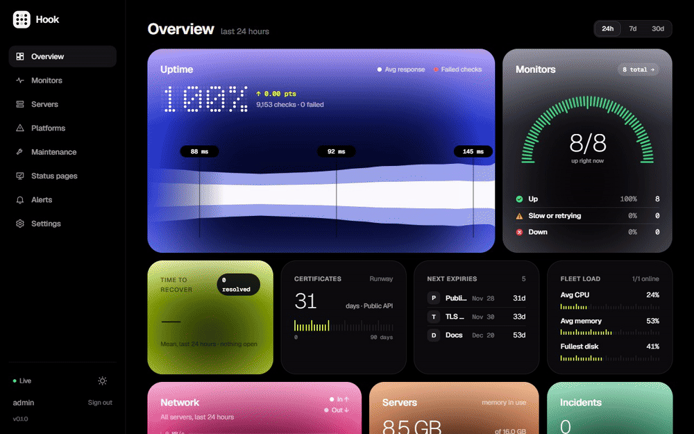
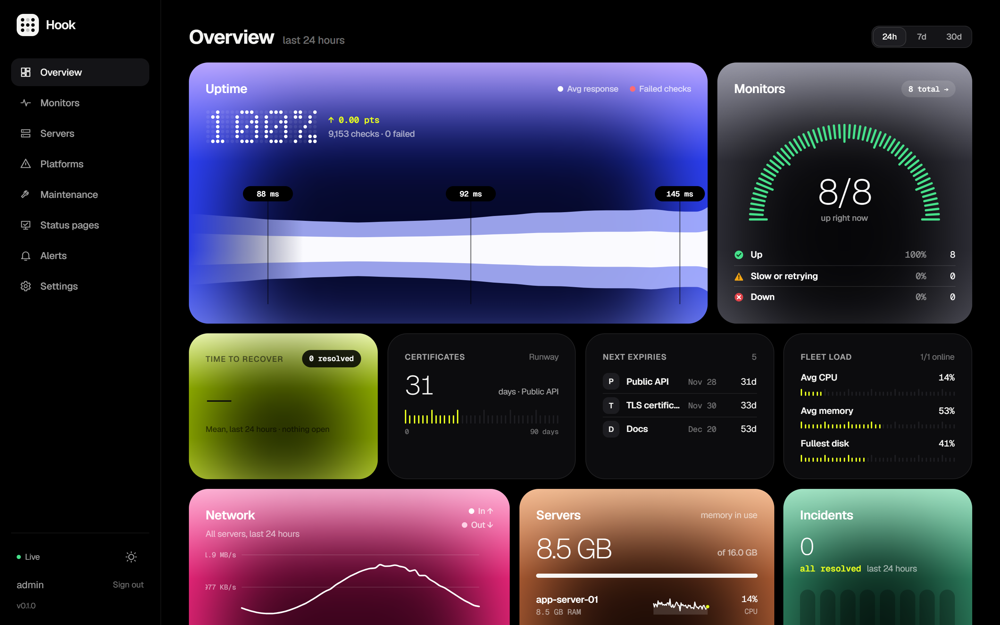
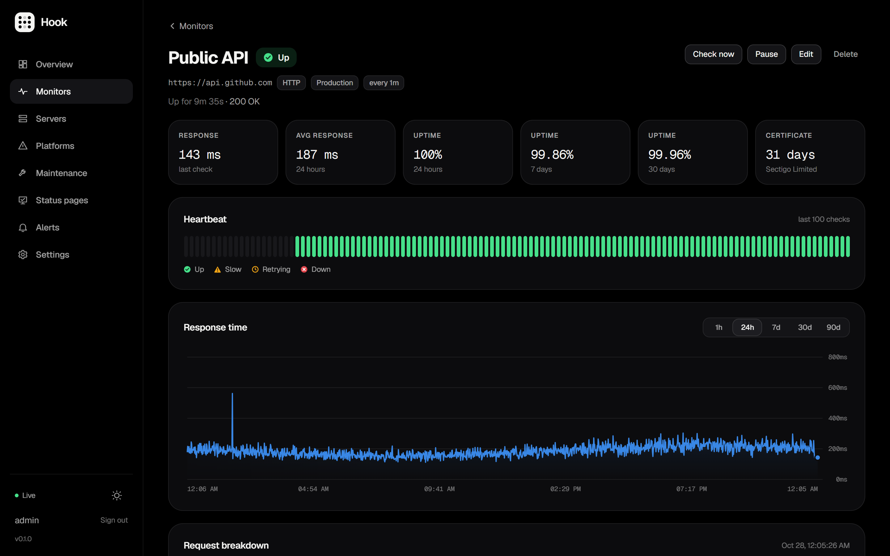
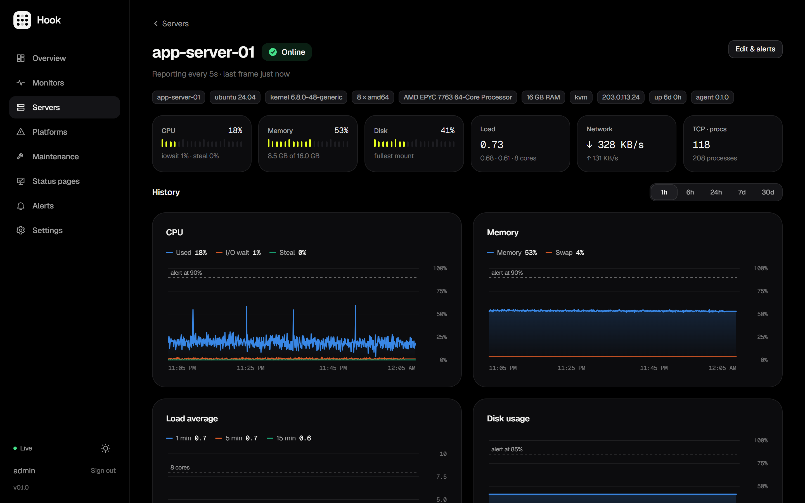
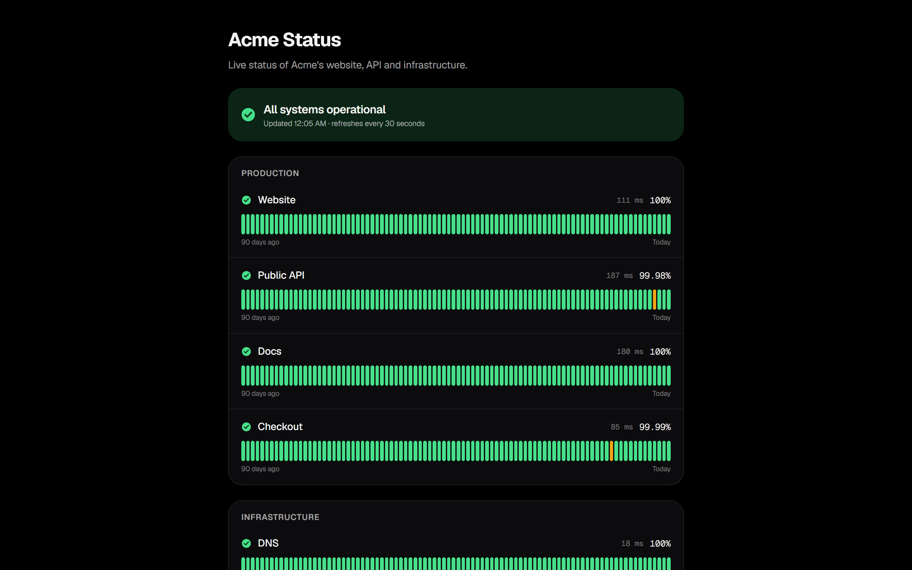
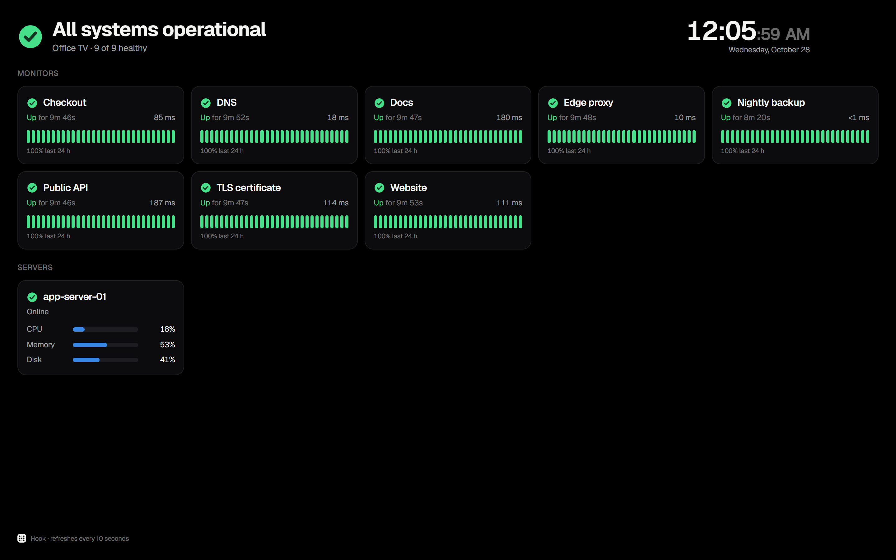
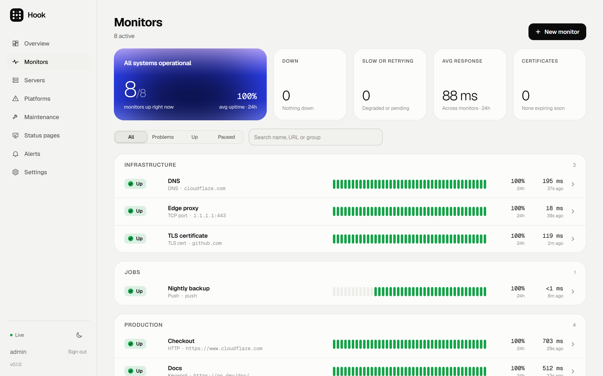

<div align="center">

<picture>
  <source media="(prefers-color-scheme: dark)" srcset="docs/assets/logo-dark.png">
  
</picture>

<h3>Private uptime and server monitoring in one binary.</h3>

Websites, APIs, databases, cron jobs and your VPS fleet: one Go binary with the dashboard built in, SQLite for storage, and a tiny agent for your servers.

<p>
  
  
  
  
</p>

<a href="docs/INSTALLATION.md">Install</a> ·
<a href="docs/FEATURES.md">Features</a> ·
<a href="docs/DOCUMENTATION.md">Documentation</a> ·
<a href="docs/SECURITY.md">Security</a>

<sub>Created by <a href="https://github.com/k4ran909">k4ran909</a> · Original repository: <a href="https://github.com/k4ran909/HooK">k4ran909/HooK</a></sub>

<br><br>



</div>

## Why Hook

- **Every check in one place:** HTTP, keyword, TCP, DNS, TLS certificates, PostgreSQL, MySQL, Redis, MongoDB, push (cron) monitors, and Vercel and Render deploys.
- **Live server metrics:** a lightweight agent streams CPU, memory, disk, network, GPU, Docker and systemd state every 5 seconds.
- **Alerts that don't cry wolf:** retries, multi-location confirmation, maintenance windows and flap limits. Alerts go to Telegram, Slack, Discord, email, ntfy, webhooks and browser push.
- **Share the good news:** public status pages and a full-screen kiosk board for the office TV.
- **Small and private:** no cloud account and no external database. Secrets are encrypted at rest, with argon2id passwords and TOTP two-factor sign-in.

## Screenshots

<table>
  <tr>
    <td width="50%"><p align="center"><sub>Overview</sub></p></td>
    <td width="50%"><p align="center"><sub>Monitor detail</sub></p></td>
  </tr>
  <tr>
    <td width="50%"><p align="center"><sub>Server metrics</sub></p></td>
    <td width="50%"><p align="center"><sub>Public status page</sub></p></td>
  </tr>
  <tr>
    <td width="50%"><p align="center"><sub>Kiosk board</sub></p></td>
    <td width="50%"><p align="center"><sub>Light theme</sub></p></td>
  </tr>
</table>

## Quick start

With Docker:

```bash
docker run -d --name hook -p 8080:8080 -v hook-data:/data fluxnat/hook
```

From source (Go 1.27+, Node 24+):

```bash
make build && ./bin/hub
```

Open http://localhost:8080 and create the admin account. To watch a server, go to **Servers → Add server** and run the one-line install command it gives you on that VPS.

For HTTPS, systemd, backups and agent options, see [Installation](docs/INSTALLATION.md).

## Documentation

| Guide | What's inside |
|---|---|
| [Features](docs/FEATURES.md) | Every check type, alert, chart and page in detail |
| [Installation](docs/INSTALLATION.md) | Local runs, deploying to a VPS, connecting servers |
| [Configuration](docs/CONFIGURATION.md) | Environment variables for the hub and the agent |
| [Operations](docs/OPERATIONS.md) | Health checks, dead-man switch, backups, restore, recovery |
| [Webhooks](docs/WEBHOOKS.md) | Webhook payload and signature |
| [Security](docs/SECURITY.md) | Security model and the 2026 audit |
| [Roadmap](PLAN.md) | How Hook was planned and built |

## Origin

**HooK** was created by [k4ran909](https://github.com/k4ran909).
