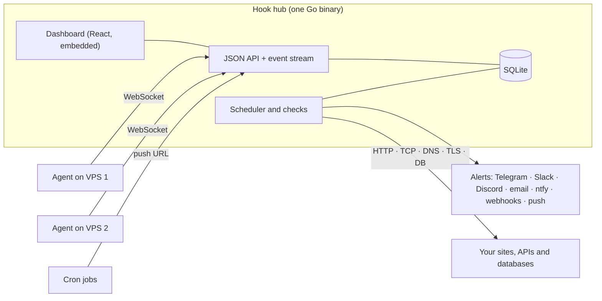

# Hook documentation

[← Back to README](../README.md)

| Guide | What's inside |
|---|---|
| [Features](FEATURES.md) | Check types, alerts, the overview, servers, integrations, status pages and kiosk mode |
| [Installation](INSTALLATION.md) | Running locally, deploying to a VPS or Docker, connecting servers and probe locations |
| [Configuration](CONFIGURATION.md) | Every environment variable for the hub and the agent |
| [Operations](OPERATIONS.md) | Health checks, the dead-man switch, backups, restore and account recovery |
| [Webhooks](WEBHOOKS.md) | Webhook payload, events and signature |
| [Security](SECURITY.md) | Security model and audit results |
| [Roadmap](../PLAN.md) | The original build plan, phase by phase |

## Architecture at a glance

- **Hub:** serves the dashboard, the API, public status pages and kiosk boards. It runs every check and sends every alert.
- **Agent:** a small static binary on each server. It only connects out, opens no ports and never runs commands from the hub.
- **Storage:** one SQLite database plus `secret.key`. Back up both (see [Operations](OPERATIONS.md#backups-and-restore)).
